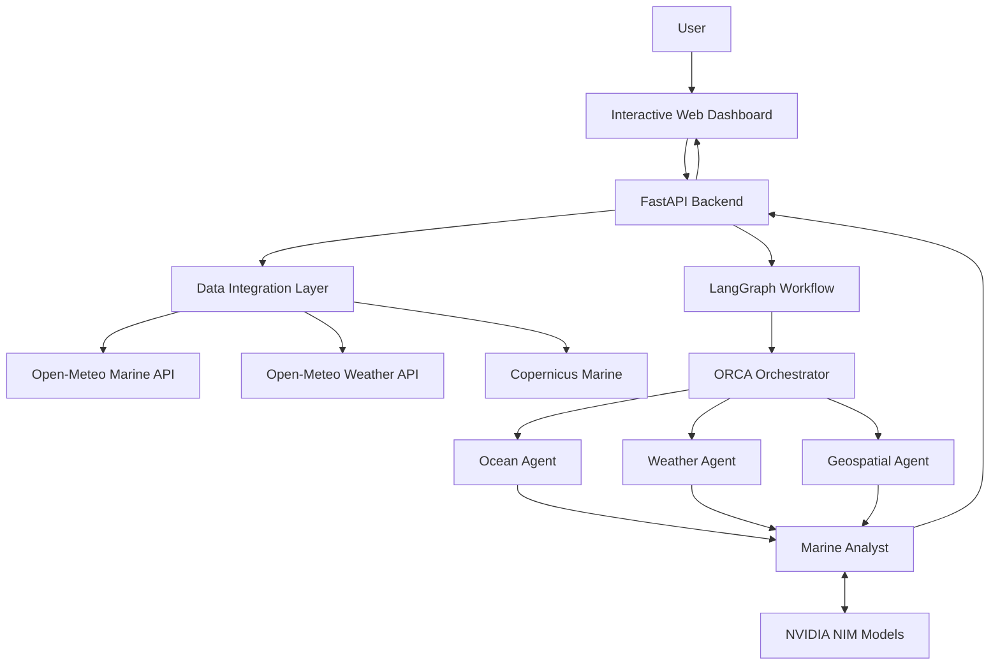

<div align="center">

# 

### __ORCA__ 🌊
### Marine EcOsystem Reasoning with Collaborative Agents

**An AI-assisted marine intelligence and decision-support platform for India's coastline.**

[](https://www.python.org/)
[](https://fastapi.tiangolo.com/)
[](https://www.langchain.com/langgraph)
[](https://build.nvidia.com/)
[](https://www.docker.com/)
[](#limitations-and-responsible-use)

*Turning ocean, weather and geospatial data into explainable marine insights.*

</div>

---

## 📌 Overview


https://github.com/user-attachments/assets/fe904401-d11e-4723-900e-163d6e8d1a0f


ORCA (Marine EcOsystem Reasoning with Collaborative Agents) is a multi-agent marine intelligence prototype designed to bring ocean observations, weather forecasts and geospatial context into one interactive workspace.

A user can explore forecast conditions across a coastal grid, inspect individual locations, ask natural-language questions and view model-assisted explanations. ORCA coordinates specialist agents for ocean data, weather and safety context, and geospatial analysis. A marine analyst combines the available evidence into a readable response.

The project includes a browser-based marine dashboard, a FastAPI backend, a LangGraph workflow, integrations with Open-Meteo and Copernicus Marine, and optional NVIDIA NIM-powered reasoning.

> **Project principle:** ORCA distinguishes retrieved data, rule-based estimates, model-generated explanations and unavailable information. It must not present missing measurements or illustrative boundaries as verified facts.

## ✨ Highlights

| Capability | What it does |
|---|---|
| 🗺️ Coastal dashboard | Interactive map focused on the Indian coastline with a forecast grid and selectable marine layers. |
| 🌡️ Ocean conditions | Explore sea-surface temperature, wave height and ocean-current velocity/direction. |
| 🌬️ Weather context | View 10 m wind speed and direction alongside marine conditions. |
| 🧪 Biogeochemical layers | Optional Copernicus Marine layers for salinity, chlorophyll-a, pH, dissolved oxygen and phytoplankton-carbon biomass. |
| ⏱️ Forecast timeline | Browse forecast hours and select a date for supported data windows. |
| 🚨 Risk assessment | Transparent threshold-based wave and wind assessment, plus forecast-derived alert windows. |
| 🤖 Collaborative agents | LangGraph coordinates the orchestrator, ocean, weather, geospatial and analyst components. |
| 🧠 LLM explanations | NVIDIA NIM models can explain the retrieved evidence; multiple configured models provide failover. |
| 💬 Natural-language queries | Ask about marine conditions in supported coastal locations, with multilingual script detection. |
| 🧭 Route experiments | Illustrative route scoring samples forecast risk along candidate paths. |
| 🛟 Geofence demo | Demonstrates point-in-polygon checks using clearly labelled illustrative polygons. |
| 🔌 REST API | FastAPI endpoints expose grid, point, alert, geofence and agent-query functionality. |
| 🐳 Container support | Dockerfile and Docker Compose configuration for local container deployment. |

## 🖥️ Application at a glance

The web interface is served by the FastAPI application at `http://localhost:8000`.

- **Map and layers:** temperature, waves, wind, currents, sea level and optional Copernicus Marine layers.
- **Ask ORCA:** natural-language marine questions and location-aware responses.
- **Timeline:** date and forecast-hour navigation.
- **Insights:** forecast-derived alerts and geofence information.

> Add your own screenshots to `docs/images/` and embed them here when preparing a public project showcase. No screenshots are included in this source archive.

## 🏗️ System architecture



### Agent responsibilities

| Component | Responsibility |
|---|---|
| **ORCA Orchestrator** | Interprets the user request and coordinates the specialist workflow. |
| **Ocean Agent** | Retrieves marine forecast values such as SST, wave height and current conditions. |
| **Weather Agent** | Retrieves wind conditions and prepares weather context for assessment. |
| **Geospatial Agent** | Provides the geospatial response structure; live legal-boundary and PostGIS integrations are not yet connected. |
| **Marine Analyst** | Combines agent outputs, calculates summaries and asks the configured LLM for a conservative explanation. |
| **Model Manager** | Connects to configured NVIDIA NIM models and attempts the next configured model when a request fails. |

The specialist agents are connected as parallel branches in the LangGraph workflow. Their outputs are merged before the analyst produces the final response.

## 📡 Data sources and coverage

| Data | Source | Credentials | Resolution / notes |
|---|---|---|---|
| Sea-surface temperature | [Open-Meteo Marine](https://open-meteo.com/en/docs/marine-weather-api) | No key for the public endpoint | Hourly forecast steps |
| Wave height | Open-Meteo Marine | No key for the public endpoint | Hourly forecast steps |
| Ocean-current velocity and direction | Open-Meteo Marine | No key for the public endpoint | Hourly forecast steps |
| Wind speed and direction | [Open-Meteo Forecast](https://open-meteo.com/en/docs) | No key for the public endpoint | Hourly forecast steps |
| Sea-level height | Open-Meteo Marine | No key for the public endpoint | Requested hourly; not a substitute for an official tide service |
| Salinity | [Copernicus Marine](https://data.marine.copernicus.eu/) | Free account credentials | Configured daily product |
| Chlorophyll-a | Copernicus Marine | Free account credentials | Configured daily product; not an official PFZ advisory |
| pH and dissolved oxygen | Copernicus Marine | Free account credentials | Configured daily products |
| Phytoplankton-carbon biomass | Copernicus Marine | Free account credentials | Biomass proxy, not a fish-stock estimate |

### Important temporal-resolution note

The dashboard's forecast timeline is hourly. The configured Copernicus Marine biogeochemical products use daily (`P1D`) datasets. Their daily values are mapped onto the hourly display positions for synchronized playback; this does **not** create 24 independent observations. Interpolation can smooth display transitions but cannot add measurements that the source does not contain.

## 🧰 Technology stack

- **Backend:** Python, FastAPI, Uvicorn, Pydantic
- **Agent orchestration:** LangGraph
- **LLM provider:** NVIDIA NIM through the OpenAI-compatible client
- **Marine and weather data:** Open-Meteo APIs, Copernicus Marine Toolbox
- **Scientific processing:** NumPy, SciPy, xarray
- **Frontend:** HTML, CSS, JavaScript, Leaflet-based map interface
- **Deployment:** Docker and Docker Compose

## 📁 Repository structure

```text
ORCA/
├── agents/
│   ├── analyst_agent.py       # Combines evidence and creates the final explanation
│   ├── geospatial_agent.py    # Geospatial context and integration boundary
│   ├── ocean_agent.py         # Marine forecast specialist
│   └── weather_agent.py       # Weather and wind specialist
├── analysis/                  # Analysis package namespace
├── core/
│   ├── graph.py               # LangGraph workflow definition
│   ├── model_manager.py       # NVIDIA NIM model clients and failover
│   ├── orchestrator.py        # Agent planning and coordination
│   ├── state.py               # Shared workflow state
│   └── tools.py               # Language, alerts, geofence and route utilities
├── data/
│   ├── cmems.py               # Copernicus Marine integration
│   ├── geofences.py           # Illustrative demo polygons
│   └── open_meteo.py          # Open-Meteo API adapters
├── scripts/
│   └── check_data.py          # Data-source diagnostic
├── static/
│   └── index.html             # ORCA web dashboard
├── tests/
│   ├── test_open_meteo.py     # Manual live API connectivity check
│   └── test_rules.py          # Network-free unit tests
├── .dockerignore
├── .env.example               # Safe configuration template (no credentials)
├── .gitignore
├── config.py                  # Environment and model configuration
├── main.py                    # CLI entry point and city resolution
├── model_check.py             # NVIDIA NIM connectivity/model check
├── server.py                  # FastAPI routes and application entry point
├── Dockerfile
├── docker-compose.yml
├── requirements.txt
└── README.md
```

## 🚀 Getting started

### 1. Prerequisites

- Python **3.11 or newer**
- Git
- NVIDIA NIM API key for LLM-powered agent responses
- Copernicus Marine account for the optional biogeochemical layers
- Docker Desktop (optional, for container deployment)

### 2. Clone the repository

```bash
git clone https://github.com/YOUR-USERNAME/ORCA.git
cd ORCA
```

### 3. Create and activate a virtual environment

**Windows PowerShell**

```powershell
python -m venv .venv
.\.venv\Scripts\Activate.ps1
```

**Linux / macOS**

```bash
python3 -m venv .venv
source .venv/bin/activate
```

### 4. Install dependencies

```bash
python -m pip install --upgrade pip
pip install -r requirements.txt
```

### 5. Configure environment variables

Copy the example file:

**Windows PowerShell**

```powershell
Copy-Item .env.example .env
```

**Linux / macOS**

```bash
cp .env.example .env
```

Edit `.env` and provide your own credentials:

- `NVIDIA_NIM_1_KEY` and `MODEL_1` — required to enable the LLM agent workflow.
- `CMEMS_USERNAME` and `CMEMS_PASSWORD` — required for the optional Copernicus Marine layers.
- Additional `NVIDIA_NIM_2_KEY` / `MODEL_2` pairs are optional and used for model failover.

Get credentials from [NVIDIA Build](https://build.nvidia.com/) and [Copernicus Marine](https://data.marine.copernicus.eu/). Never commit `.env` or paste credentials into source files.

### 6. Start the web application

```bash
uvicorn server:app --reload --host 127.0.0.1 --port 8000
```

Open **http://127.0.0.1:8000** in your browser.

Useful development URLs:

- Dashboard: http://127.0.0.1:8000/
- API documentation: http://127.0.0.1:8000/docs
- Alternative API docs: http://127.0.0.1:8000/redoc
- Health check: http://127.0.0.1:8000/api/health

### 7. Optional: run the command-line agent

```bash
python main.py
```

Example questions:

```text
Ask ORCA > What are the ocean and safety conditions near Mumbai tomorrow?
Ask ORCA > What is the wave height near Chennai?
Ask ORCA > Route from Mumbai to Goa
```

### 8. Optional: run with Docker Compose

Create and configure `.env` first, then run:

```bash
docker compose up --build -d
```

Open http://localhost:8000.

Stop the service:

```bash
docker compose down
```

## 🔌 API reference

Interactive request and response schemas are available at `/docs`. The main endpoints are:

| Method | Endpoint | Purpose |
|---|---|---|
| `GET` | `/api/health` | Backend and agent availability status. |
| `GET` | `/api/cities` | Returns the configured coastal city list and coordinates. |
| `GET` | `/api/grid` | Returns the coastal forecast grid and timeline. |
| `GET` | `/api/grid/ocean` | Returns additional Copernicus Marine layers and availability metadata. |
| `GET` | `/api/point?lat=18.90&lon=72.70` | Returns a point forecast and safety assessment. |
| `GET` | `/api/alerts?lat=18.90&lon=72.70` | Returns forecast-derived alert windows for a location. |
| `GET` | `/api/alerts/overview` | Returns an overview of alerts across configured cities. |
| `GET` | `/api/geofences` | Returns the illustrative geofence polygons. |
| `GET` | `/api/geofence/check?lat=18.90&lon=72.70` | Checks a coordinate against demo geofences. |
| `POST` | `/api/ask` | Runs the ORCA query workflow and returns the answer, values and UI hints. |

Most forecast endpoints accept a `date=YYYY-MM-DD` query parameter. The backend validates a supported window of 60 days in the past through 7 days ahead.

### Example: ask ORCA

```bash
curl -X POST "http://127.0.0.1:8000/api/ask" \
  -H "Content-Type: application/json" \
  -d '{"query":"Are wave and wind conditions safe near Chennai tomorrow?","session_id":"demo-session"}'
```

Optional request fields include `lat`, `lon`, `session_id` and `date`. The response contains the interpreted location, forecast values, assessment, alert windows, geofence information, agent status and generated explanation (when the LLM workflow is available).

## 🧪 Testing and diagnostics

Run the network-free unit tests:

```bash
python -m unittest discover -s tests -p "test_*.py" -v
```

Check Python syntax:

```bash
python -m compileall -q .
```

Check configured data sources (makes external API requests and may require Copernicus credentials):

```bash
python -m scripts.check_data
```

Check the Open-Meteo connection directly (makes a live request):

```bash
python tests/test_open_meteo.py
```

The live connectivity checks depend on network access and upstream provider availability. The unit tests do not require API credentials.

## ⚙️ Configuration

| Variable | Required | Description |
|---|---|---|
| `NVIDIA_NIM_BASE_URL` | For LLM agents | NVIDIA NIM OpenAI-compatible API base URL. |
| `NVIDIA_NIM_1_KEY` | For LLM agents | First NVIDIA NIM API key. |
| `MODEL_1` | For LLM agents | Model identifier paired with the first key. |
| `NVIDIA_NIM_2_KEY`, `MODEL_2`, … | Optional | Additional model/key pairs for failover (up to 10). |
| `CMEMS_USERNAME` | For Copernicus layers | Copernicus Marine account username. |
| `CMEMS_PASSWORD` | For Copernicus layers | Copernicus Marine account password. |
| `CMEMS_DS_*` | Optional | Override a configured Copernicus dataset identifier. |
| `CMEMS_VAR_*` | Optional | Override the variable name for a Copernicus layer. |
| `CORS_ORIGINS` | Optional | Comma-separated allowed browser origins; use explicit origins in production. |

## ⚠️ Limitations and responsible use

ORCA is a **research / demonstration prototype**, not a certified navigation, fishing, weather-warning or emergency-response system.

- The risk score is a transparent prototype rule based on wave-height and wind-speed thresholds. It is not a calibrated maritime safety model.
- Open-Meteo forecast data is not an official Indian fishing advisory or an IMD warning.
- The current geofence polygons in `data/geofences.py` are illustrative demo shapes, not legally authoritative maritime boundaries, EEZ limits, IMBL limits or marine protected-area definitions.
- Route scoring is experimental. It samples forecast risk and does not reliably model coastlines, bathymetry, currents, vessel capabilities, traffic separation schemes or legal restrictions. Do not use it for real navigation.
- The current geospatial agent is an integration scaffold. A production PostGIS / authoritative-boundary integration remains future work.
- No official Potential Fishing Zone (PFZ) advisory is generated. A genuine PFZ workflow requires validated official inputs and domain validation. Chlorophyll or phytoplankton biomass alone is not a fish-location guarantee.
- Daily Copernicus Marine values displayed along an hourly timeline remain daily source observations.
- LLM responses can be incomplete or incorrect. Verify important decisions against authoritative services and qualified professionals.

For operational decisions at sea, follow official IMD, INCOIS, maritime authority and local emergency guidance.

## 🛣️ Roadmap

- [ ] Integrate official INCOIS PFZ advisories and provenance metadata.
- [ ] Add official IMD warning feeds and alert attribution.
- [ ] Connect authoritative maritime boundaries and marine protected-area datasets.
- [ ] Replace illustrative geofences with validated spatial data and PostGIS.
- [ ] Improve route planning with coastline, bathymetry, vessel and regulatory constraints.
- [ ] Add automated integration tests with mocked provider responses.
- [ ] Add deployment hardening, observability and API authentication.
- [ ] Add dashboard screenshots, demo video and reproducible sample scenarios.

## 🤝 Contributing

Contributions, bug reports and ideas are welcome. Before opening a pull request:

1. Create a focused branch for your change.
2. Keep credentials and private configuration out of commits.
3. Run the unit tests and Python syntax check.
4. Document new data sources, assumptions and limitations.
5. Include screenshots for meaningful dashboard changes where possible.

## 🔐 Security

Do not commit API keys, passwords, `.env` files, private datasets or production credentials. If a credential is exposed, revoke or rotate it with its provider immediately. See [SECURITY.md](SECURITY.md) for reporting guidance.

## 📄 License

No license has been added to this repository yet. Add a license file before permitting reuse, redistribution or contributions under specific legal terms.

---

<div align="center">

**ORCA — Marine EcOsystem Reasoning with Collaborative Agents**  
*Explore the ocean. Understand the conditions. Make evidence-aware decisions.*

</div>
